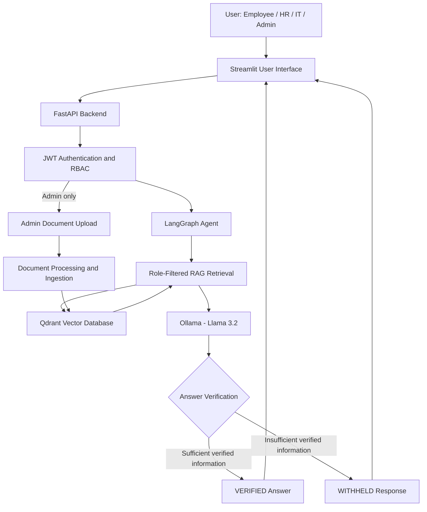

# Enterprise Agentic RAG Assistant — System Architecture

## 1. Architecture Overview

The Enterprise Agentic RAG Assistant combines retrieval-augmented generation (RAG), AI agent orchestration, and role-based access control to provide secure access to enterprise knowledge.

The application uses **LangGraph** for workflow orchestration, **Qdrant** for vector retrieval, **Ollama** for local LLM inference, **FastAPI** for backend services, and **Streamlit** for the user interface.

## 2. System Architecture Diagram

## 3. Main Components

### Streamlit

Provides the interactive interface for user authentication, questions, answers, and administrative document uploads.

### FastAPI

Exposes backend endpoints and validates JWT authentication before processing protected requests.

### LangGraph

Coordinates the assistant's retrieval and response-generation workflow.

### Qdrant

Stores document embeddings and metadata used for role-filtered knowledge retrieval.

### Ollama

Runs the Llama 3.2 language model locally for response generation.

### Security Layer

Enforces document access restrictions for Employee, HR, IT, and Admin roles.

### Answer Verification

Returns a VERIFIED response when sufficient supporting information is available or a WITHHELD response when the system cannot provide a verified answer.

## 4. Security Testing

The project includes automated tests for role-based access control and administrative document uploads.

**Current result: 21 automated tests passed inside Docker.**

## 5. Deployment

The application uses Docker Compose for its FastAPI and Streamlit services. Ollama and Qdrant are accessed through separately running local services in the current development environment.
